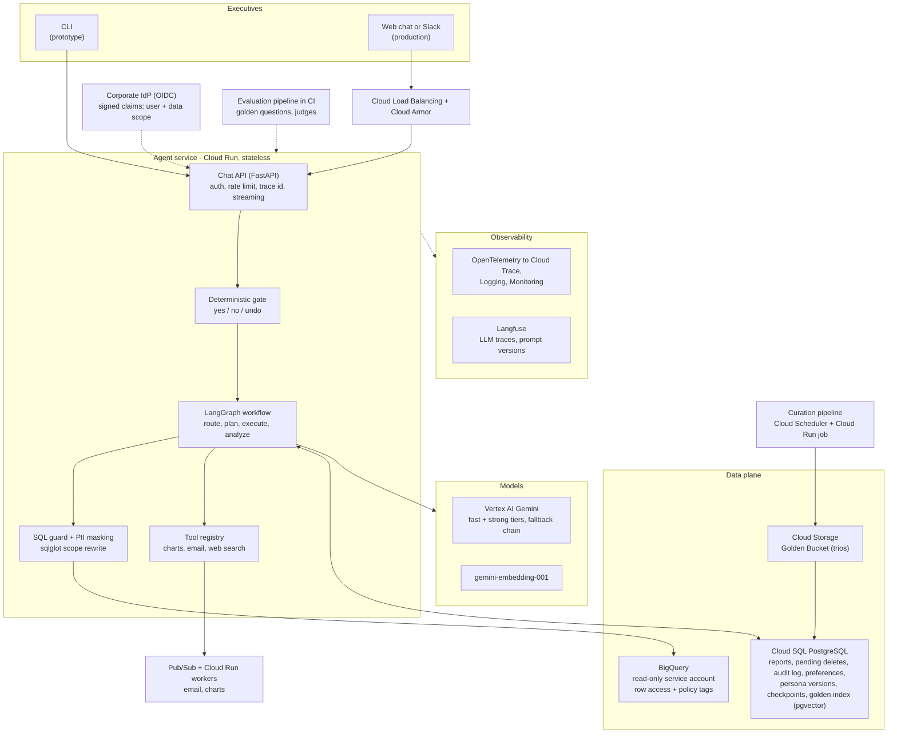
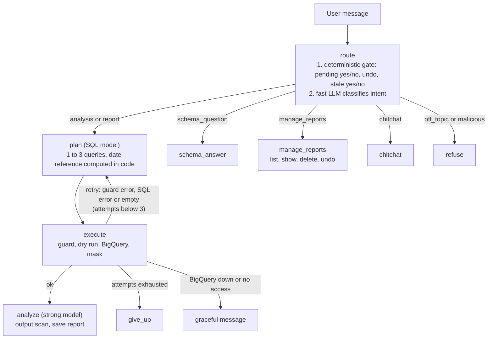
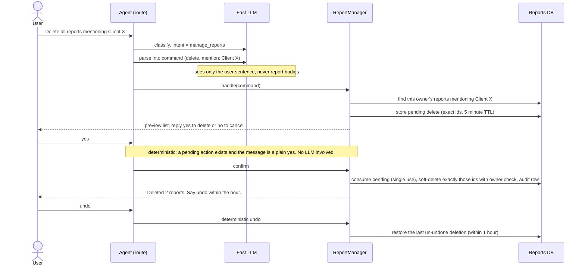
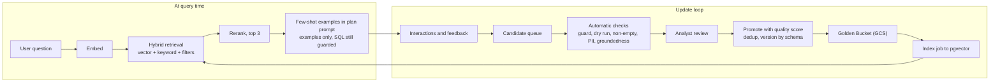

# Architecture and technical explanation

Data-analysis chat assistant for a retail company's non-technical executives, built on
`bigquery-public-data.thelook_ecommerce`.

This document has two halves that are kept honestly separate:

* the **production design** (high-level design, services, data flow), and
* the **prototype** in this repository, which implements the four requirements the brief asks to be built
  (safety and PII, high-stakes oversight, resilience, observability) plus persona management.

Setup instructions and an example run are in the [README](../README.md#quick-start). The assumptions this design rests on are in
[assumptions.md](assumptions.md).

## Contents

0. [Requirements at a glance](#0-requirements-at-a-glance)
1. [Production architecture (HLD)](#1-production-architecture-hld)
2. [Why these services, models and frameworks](#2-why-these-services-models-and-frameworks)
3. [Data flow of one turn](#3-data-flow-of-one-turn)
4. [Requirement by requirement](#4-requirement-by-requirement)
5. [Error handling and fallback strategies](#5-error-handling-and-fallback-strategies)
6. [Extensibility](#6-extensibility-charts-email-web-search)
7. [What building it against real data taught me](#7-what-building-it-against-real-data-taught-me)
8. [Known limitations](#8-known-limitations-and-next-steps)

---

## 0. Requirements at a glance

| # | Requirement | In the prototype | Where |
|---|---|---|---|
| 1 | Hybrid intelligence (Golden Bucket) | **Design only** (the brief marks the bucket theoretical) | [4.1](#41-hybrid-intelligence-the-golden-bucket) |
| 2 | Safety and PII masking | **Built** | [4.2](#42-safety-and-pii-masking), `src/sql_guard.py`, `src/masking.py`, `src/access.py` |
| 3 | High-stakes oversight (destructive ops) | **Built** | [4.3](#43-high-stakes-oversight-destructive-operations), `src/reports.py` |
| 4 | Continuous improvement | **Design only** (the analyst prompt already accepts a `prefs` dict, but nothing populates it) | [4.4](#44-continuous-improvement-the-learning-loop) |
| 5 | Resilience and graceful errors | **Built** | [4.5](#45-resilience-and-graceful-error-handling), `src/llm.py`, `src/bq.py`, `src/agent.py` |
| 6 | Quality assurance | 131 deterministic tests with fake LLM and fake BigQuery; **LLM-evaluation harness is design only** | [4.6](#46-quality-assurance) |
| 7 | Observability | **Built** (JSONL traces, `src/trace_report.py`); production stack is design | [4.7](#47-observability) |
| 8 | Persona management | **Built** (`config/persona.md` is re-read every turn); production registry is design | [4.8](#48-agility-persona-management) |

---

## 1. Production architecture (HLD)



*Static image of this diagram: [img/hld.png](img/hld.png).*

### Components

| Component | Service | Why this | Talks to | Data it holds |
|---|---|---|---|---|
| Chat API | Cloud Run (FastAPI) | Stateless, scales with load, per-request billing, streaming responses | IdP, agent workflow | Nothing durable |
| Identity and scope | Corporate IdP through OIDC (Identity Platform or Workforce Identity Federation) | The user's data scope must come from signed claims, never from chat text | Chat API | Brand and department scope as claims |
| Agent workflow | LangGraph inside the Cloud Run service | Explicit state machine, deterministic safety nodes, bounded retries | Models, guard, state DB, tools | Per-turn state, checkpointed to Postgres so a turn survives an instance restart |
| LLMs | Vertex AI (Gemini) | IAM and VPC-SC integration, regional control, quotas and provisioned throughput; the prototype uses the Gemini API with a free key | Agent workflow | Nothing stored by us |
| Warehouse | BigQuery | Mandated by the brief | SQL guard only | Raw transaction tables |
| State database | Cloud SQL for PostgreSQL (HA, point-in-time recovery) | The delete flow needs real transactions (single-use confirmation); one store also serves preferences, audit and the golden index | Agent workflow, curation jobs | Reports, pending deletes, audit log, preferences, persona versions, checkpoints, golden trio index |
| Golden Bucket | Cloud Storage | Source of truth for expert trios, versioned and cheap | Curation pipeline | Trios as JSON |
| Async work | Pub/Sub and Cloud Run workers | Email and chart rendering must not block a chat turn | Tool registry | Job messages |
| Observability | OpenTelemetry to Cloud Trace/Logging/Monitoring, plus Langfuse | Platform metrics and alerting, plus LLM-specific traces and prompt versions | All services | Spans, metrics, redacted transcripts |
| Secrets | Secret Manager | No keys in images or config | Chat API | API keys, salts |

Network and data-exfiltration controls: Cloud SQL on private IP, VPC Service Controls around BigQuery and Cloud Storage,
a dedicated read-only service account for BigQuery, Cloud Armor in front of the load balancer.

### The prototype's graph

This is the part of the design that exists in code (`src/agent.py`). The deterministic gate lives at the top of the
`route` node.



*Static image: [img/prototype-graph.png](img/prototype-graph.png).*

---

## 2. Why these services, models and frameworks

### 2.1 Framework: LangGraph

The control flow of this problem is known in advance: classify, plan SQL, validate, run, explain, with a few loops.
That argues for an explicit graph rather than a free-roaming ReAct agent:

* **Safety nodes the model cannot skip.** The SQL guard and masking are graph nodes and functions in code, not
  instructions in a prompt. A model that is confused or manipulated still cannot reach BigQuery without passing the guard.
* **Bounded cost.** The retry loop has an explicit cap (`max_attempts=3`). A free-form agent decides for itself how many
  tool calls to make.
* **Testable.** Each node is a function over a typed state, so the whole graph is tested with fake LLMs and a fake
  BigQuery (`tests/test_agent.py`).
* **Production path.** LangGraph's checkpointer lets state live in Postgres, and `interrupt` style human-in-the-loop fits
  the confirmation flow.

Trade-offs accepted: more upfront structure than a prompt-driven agent, and a dependency on the LangGraph API. The model
layer (`src/llm.py`) is deliberately **not** LangChain: it is a thin wrapper around `google-genai`, so retries, fallback,
timeouts and telemetry are ours and swapping provider is one file.

> **Experience with LangGraph:** *to be completed by the author before submission: how long and in what kind of
> projects LangGraph has been used, and what this prototype taught.*

### 2.2 Models

Two tiers, chosen by measurement rather than by name. On 2026-11-11 `scripts/probe_models.py` sent a trivial prompt three
times to each candidate on the free tier:

| Model | Success | Average latency | Note |
|---|---|---|---|
| `gemini-3.1-flash-lite` | 3/3 | 1.2 s | **Fast tier**: routing, report-command parsing, small talk, schema answers |
| `gemini-3.5-flash` | 3/3 | 1.8 s | **Strong tier**: SQL planning and report writing |
| `gemini-flash-latest` | 3/3 | 2.4 s | Fallback |
| `gemini-3.7-flash` | 3/3 | 8.6 s | Works but too slow for chat |
| `gemini-3.6-flash` | 3/3 | 10.6 s | Works but too slow for chat |
| `gemini-pro-latest` | 0/3 | n/a | HTTP 429, no free-tier quota |

Reasoning:

* The **fast tier** only classifies and parses, so a small model is enough and keeps first-token latency low.
* The **strong tier** writes SQL and the analysis. In the first live run the small model failed a monthly-revenue question after
  three attempts, and its final SQL still used `TIMESTAMP_SUB(..., INTERVAL 6 MONTH)`, a form BigQuery does not support for
  timestamps. With the strong model on SQL the same question succeeded, hence `SQL_MODEL_TIER=strong`.
* **Production** would use Vertex AI with provisioned or paid quota and could put a Pro-class model on the report-writing
  step for quality. Model names change often, so they are configuration (`.env`), never code.
* **Embeddings** (golden bucket): `gemini-embedding-001`, requested at 768 dimensions so a pgvector HNSW index fits
  (pgvector indexes up to 2,000 dimensions; the model's native 3,072 would not).

### 2.3 Data stores

* **BigQuery**: mandated. Queries run under a dedicated read-only identity.
* **PostgreSQL (Cloud SQL) with pgvector** for state and the golden index. At the assumed scale (a few thousand to tens of
  thousands of trios) pgvector with SQL metadata filters is simpler and cheaper than a dedicated vector service, and it
  keeps transactional state and retrieval in one place. Vertex AI Vector Search is the documented scale-up path if the bucket
  grows by orders of magnitude.
* **SQLite in the prototype** (`data/reports.db`): same schema and the same transactional semantics, no server to install.

### 2.4 Why `sqlglot` for the guard

LLM-generated SQL is untrusted input. Regex filtering is bypassable; parsing into a syntax tree lets the guard reason about
what the query actually references. It also lets the guard **rewrite** the query (scope injection) instead of merely accept or
reject it.

---

## 3. Data flow of one turn

1. **Request** arrives at the Chat API with the user's signed identity. A `trace_id` is created for the turn.
   *(Prototype: the CLI passes `--user`; `handle_turn` creates the trace id.)*
2. **Deterministic gate** (inside `route`). If a deletion is awaiting confirmation and the message is a plain yes or no, or the
   message is a bare "undo", it is answered in code with no LLM call. A stale "yes" with nothing pending is answered
   "nothing is waiting", unless the assistant's last message was a question.
3. **Route.** The fast model classifies the message into one of: analysis, report, schema question, manage reports,
   chitchat, off-topic, malicious. A message classified as anything other than report management also cancels a pending deletion.
4. **Plan** (analysis or report). The SQL model receives the schema and business definitions from
   `config/semantic_layer.yaml`, a **date reference computed in code** (so "last quarter" never depends on model arithmetic),
   the conversation, and any feedback from a failed attempt. It returns one to three queries, each with a purpose.
   *(Design: retrieved golden trios are added here, see 4.1.)*
5. **Execute.** For each query: the **SQL guard** (single read-only statement, table and column allowlists, scope rewrite, row
   limit), a BigQuery **dry run** (syntax check and bytes cap), the real query with a server-side billing cap, then
   **masking** of the result frame.
6. **Self-correct.** A guard rejection, a BigQuery error, or an all-empty result goes back to step 4 with the error text, up to
   three attempts, then a graceful message.
7. **Analyze.** The strong model receives only masked results (at most 40 rows per query), the SQL that produced them, the
   user's data scope, the persona (read from `config/persona.md` on every turn) and preferences. Its output passes an **output
   scanner**.
8. **Persist and respond.** Report requests are saved to the user's library (a save failure appends a note and never loses the
   analysis). The answer, the SQL and the trace id are returned.
9. **Telemetry.** Every step wrote a JSON event keyed by the trace id (`logs/traces.jsonl`).

The delete flow is a separate path through `manage_reports`:



---

## 4. Requirement by requirement

### 4.1 Hybrid intelligence: the Golden Bucket

*Design only. The prototype does not read a golden bucket.*

**What a trio holds.**
`{id, question, canonical_question, sql, report, interpretation_notes, tables, metrics, tags, scope: generic|brand-specific,
quality_score, source: analyst|agent_promoted, usage_count, schema_version, created_at, status}`.
`interpretation_notes` is the valuable part: one or two sentences on how the analyst read an ambiguous question (for example,
what "churn" meant, which orders were excluded).

**Providing relevant knowledge at query time** (target budget: under 300 ms, no extra LLM call on the hot path):

1. Embed the user question (cached by hash).
2. Retrieve candidates from pgvector with metadata filters (`status = active`, current `schema_version`, quality above a floor,
   `scope = generic` or matching) and, in parallel, a keyword search (Postgres full text). Fuse the two ranked lists with
   reciprocal rank fusion.
3. Rerank the top candidates with a small cross-encoder or a fast-model scoring call, keep the top three.
4. Inject into the **plan prompt** as few-shot examples: question, SQL and interpretation notes. For the **analyst prompt**
   inject only the structure and tone of the best-matching report, trimmed to a token budget.
5. **Similarity floor.** If the best match is below a threshold, inject nothing and log a `golden_miss`. A bad example is worse
   than none, and misses are the input to curation.

Trust model: retrieved SQL is an *example*, never trusted. The generated query still passes the guard, scope rewrite and dry
run. Brand-specific trios are filtered or have literals replaced by placeholders so one client's names cannot leak into
another user's prompt.

**Updating the bucket over time.**

1. *Capture.* Turns with positive feedback, an analyst's explicit "save as trio", or a successful first-attempt answer to a
   frequently repeated question become **candidates** in a queue.
2. *Automatic checks.* The SQL passes the guard and a dry run, executes with a non-empty result, the report contains no PII
   (output scanner plus a DLP pass), and its numbers are traceable to the query result (see groundedness, 4.6).
3. *Human review.* An analyst approves, edits or rejects in a small internal UI. Nothing enters the bucket unreviewed.
4. *Promote and deduplicate.* Approved trios get a quality score. Candidates with near-identical embeddings are merged,
   keeping the higher-scoring one.
5. *Version and retire.* Trios record the `schema_version` they were written against. A schema change marks affected trios
   stale until re-validated. Unused or poorly rated trios are retired.
6. *Index.* A nightly job (Cloud Scheduler to a Cloud Run job) writes approved trios to Cloud Storage and refreshes the
   pgvector index.
7. *Distil into the semantic layer.* When many trios share the same interpretation of a term, that interpretation is promoted
   into `semantic_layer.yaml` as a definition, so it applies to every question and not only to similar ones.



### 4.2 Safety and PII masking

*Built.* Safety does **not** depend on the model behaving. Every layer below is enforced in code, so a successful prompt
injection still cannot widen access.

| Layer | What it does | Code |
|---|---|---|
| 1. Intent routing | Off-topic and malicious requests (injection, requests for personal data, attempts to change data) are refused before any SQL is written | `route`, `n_refuse` |
| 2. Schema shown to the model | Personal columns are absent from the schema the model sees; test asserts it | `config/semantic_layer.yaml`, `tests/test_masking.py` |
| 3. SQL guard | One statement, SELECT or UNION only; table allowlist; dataset allowlist; blocked columns rejected; CTEs may not shadow base tables; row limit enforced | `src/sql_guard.py` |
| 4. Scope rewrite | Every base table reference is replaced by a scoped subquery under the same alias: products by the user's brands or departments, order items by those products, orders and users by those items. `users` is also reduced to a PII-free column list, so even `SELECT *` cannot leak | `guard_sql`, `config/user_access.yaml` |
| 5. Result masking | Blocked columns dropped; customer ids replaced by salted-hash pseudonyms (`cust_ab12cd34`); age or city next to an id dropped; age or city aggregates with groups under 5 suppressed; string cells scrubbed | `src/masking.py` |
| 6. Output scanner | Emails and phone numbers in the final text are redacted, and each redaction is a trace event that should stay at zero | `scan_text`, event `pii_output_redacted` |
| 7. Privilege separation | The analyst model has no tools and cannot take actions. The only side effects (deleting reports) are in deterministic code with ownership checks | `src/reports.py` |

Scope model. thelook has no ownership concept, so access is a configured mapping from user to brands and departments
(`config/user_access.yaml`). Unknown users and users with an empty scope are denied (fail closed). In production the mapping
arrives as signed claims from the identity provider and is never accepted from chat text.

Defence in depth in production: BigQuery **row access policies** and **policy tags** (column-level security) beneath the
application, queries run under a read-only service account, VPC Service Controls against exfiltration, and Cloud Sensitive
Data Protection on the output instead of regexes.

Known limitation: `orders.num_of_item` counts the whole order including out-of-scope items; the semantic layer directs item
counts to `order_items`. Instructions hidden in data values (for example a product name) are a residual prompt-injection
vector for the analyst model; its lack of tools and the output scanner bound the damage to wrong text, not actions.

### 4.3 High-stakes oversight: destructive operations

*Built* (`src/reports.py`, `tests/test_reports.py`, `tests/test_quick_commands.py`). The brief asks for a strict confirmation
flow without breaking UX.

* **Two phases.** Phase 1 resolves "delete all reports mentioning Client X" or "delete the reports from this conversation"
  into a concrete list of report ids, shows it, and stores it as a *pending action* per user and conversation (5 minute TTL).
  Nothing is deleted. Phase 2 deletes **exactly the stored ids**. The search is never re-run, so the set cannot grow between
  preview and confirmation.
* **Natural confirmation, no extra commands.** The user simply answers "yes". UX cost: one extra turn, only for destructive
  actions.
* **The confirmation is parsed by code, not by the LLM.** A plain yes or no is matched against a strict list. So an injection
  cannot confirm a deletion, a model cannot be talked into one, and confirming still works while the LLM is down. A new
  deletion request replaces the pending one, and any unrelated message cancels it.
* **Ownership enforced in SQL.** Every read and delete carries `owner = ?`; deleting another user's report by id matches
  nothing. The LLM never sees report bodies in this flow.
* **Soft delete, audit log and undo.** Deleted reports are marked, not erased, and an audit row records the action. "undo"
  within an hour restores them, also answered in code with no LLM call. A production job purges after a retention period.
* **Single use.** The pending row is consumed atomically before deleting, so a double "yes" cannot delete twice.

### 4.4 Continuous improvement: the learning loop

*Design only.* The analyst prompt already takes a `prefs` dict (`analyst_system`), so the hook exists; nothing populates it yet.

**a) User level.** A `user_preferences` table: `(user_id, key, value, confidence, source, updated_at)` with **enumerated** keys
and values: format (table, bullets, prose), depth (headline, standard, deep dive), visuals (charts, text), length, focus
metrics.

* *Explicit signals* ("always give me tables") set a preference at full confidence.
* *Implicit signals* (follow-ups such as "shorter", "more detail", "chart that", thumbs ratings, which format the user copied)
  update a score with decay. A preference is only applied after at least two consistent signals, so one odd request does not
  flip a user's style.
* Because values are enumerated, preferences cannot be used to smuggle instructions into a prompt.
* Applied by rendering the top preferences into the analyst prompt. Transparent and controllable: "what do you remember about
  me?" and "forget my preferences".

**b) System level.** A weekly pipeline mines traces for failed turns, retries, guard rejections, thumbs-down and
reformulations, clusters them, and proposes changes: a new semantic-layer definition, a candidate golden trio, a prompt edit.
Every proposal must pass the evaluation gate (4.6) and be approved by a person. **Nothing deploys automatically.** Success
is measured by first-attempt success rate, retry rate and satisfaction trending in the right direction.

### 4.5 Resilience and graceful error handling

*Built.* The goals: self-correct before giving up, never crash the interface, never let cost run away, survive third-party
outages.

**LLM layer** (`src/llm.py`)

* Per-tier policy: fast tier 1 retry, 12 s per attempt, 20 s total; strong tier 2 retries, 40 s per attempt, 90 s total.
* Transient errors (408, 429, 5xx, timeouts, network, empty output, output that does not match the schema) are retried with
  exponential backoff and jitter, then the **next model in the fallback chain** is tried.
* **429 is special.** Retrying a quota-exhausted model wastes time, so the model is parked for the server-suggested
  retry delay (clamped to 15 s to 10 minutes) and the call fails over at once. A 404 (model unavailable for this key) also skips
  to the next model.
* A **shared circuit breaker** (one instance for all roles) skips a model known to be failing, then lets a probe call through
  after the cooldown, so the router and the analyst do not each rediscover the same outage.
* Permanent errors (bad key, bad request) are not retried.
* A telemetry hook failure can never break a call.

**BigQuery layer** (`src/bq.py`)

* A **dry run** catches syntax errors for free and enforces a bytes-scanned cap; the real job also carries
  `maximum_bytes_billed`, a server-side hard stop.
* Errors are classified: an invalid query or an over-expensive one is *fixable* (the message returns to the model); permission
  or outage is *infrastructure* (never looped through the model); transient errors are retried with backoff. Error text sent back
  to the model has URLs and job ids stripped.

**Agent layer** (`src/agent.py`)

* **Self-correction loop capped at three attempts** (`max_attempts`). Triggers: guard rejection, BigQuery error, no valid plan,
  all queries empty. Each retry carries the specific error text. After the cap the user gets a clear message, and the expensive
  analysis model is never called for a failed plan.
* **Empty results are treated as a signal, not an answer**: retried with feedback, and finally reported as "no data matching
  within your scope", not as a business finding.
* **Graceful degradation messages** for LLM outage, BigQuery outage, no access, no data, and unexpected errors. The top-level
  handler catches everything, so the UI never crashes.
* A **report save failure** appends a note and never loses the analysis the user waited for.
* **Deterministic paths** (yes, no, undo) keep working during an LLM outage.

**Cost controls**: bytes cap per query, three attempts maximum, token limits per call, at most 40 result rows sent to the
model, small model for classification, deadlines on every call.

**Production additions**: a second provider or region behind the same client interface, a semantic cache for repeated
questions, a queue in front of slow tool calls, and idempotency keys on tool side effects.

**Seen during development** (from the project's own logs): a 503 "high demand" on the first smoke test, a dropped connection
(`RemoteProtocolError`) retried transparently, and `gemini-pro-latest` returning 429 and being parked for about 5 minutes
while requests continued on the fallback model.

### 4.6 Quality assurance

*Prototype: 131 deterministic tests; the LLM-evaluation harness below is design only.*

**In the prototype.** Fake LLMs and a fake BigQuery drive every path: guard accept and reject cases, scope injection,
PII masking, retries and give-up, failover, deadlines, deletion confirmation, undo, ownership isolation, stale confirmations,
injection text inside report bodies, trace summaries. These tests prove the *control flow and safety properties*, not answer
quality.

**Before deployment** (design):

1. **Golden evaluation set.** A few hundred questions written with analysts, each with a reference SQL, the expected metrics and
   period, and tags (comparison, trend, why-question, report, adversarial). Stored in the repo and versioned with the semantic layer.
2. **SQL correctness: execution accuracy.** Run the generated SQL and the reference under the same scope, and compare *result
   sets* with tolerances, not SQL text. Also track valid-SQL rate, first-attempt success and retries per question.
3. **Does the report answer the user's intent?** Three checks.
   * *Groundedness (deterministic):* extract every number and date from the report and verify each traces to a query result or a
     simple derivation of one. Catches invented figures, wrong periods and unmeasured claims.
   * *Intent satisfaction (LLM judge):* given the question, results and report, score a rubric: answers the question asked,
     defines metrics, separates findings from hypotheses, actionable, correct period, right scope. The judge is calibrated
     against a human-labelled sample and re-calibrated periodically.
   * *Human review* of a rotating sample, always for report-type outputs before a prompt or persona release.
4. **Adversarial suites.** Prompt injection, requests for personal data, cross-user scope probing, destructive-op abuse. The
   gates here are **zero** tolerated PII leaks and **zero** scope leaks.
5. **Release gate in CI.** Prompt, semantic-layer, model or persona changes run the suite (Promptfoo or LangSmith style) and must
   not regress beyond thresholds, then roll out via shadow or canary traffic.

**Evaluating UX.**
* *Task-based usability tests* with five to eight executives on realistic tasks, measuring completion, time to a useful
  answer and where they hesitate.
* *Behavioural signals:* reformulation rate (the user rewords the same question), follow-up depth, abandonment, thumbs, clarification
  requests, **false refusal rate** (legitimate questions refused), and the delete-flow funnel (proposed, confirmed, cancelled,
  undone).
* *Survey:* a short satisfaction score after sessions, plus A/B tests for persona and answer-format changes.

### 4.7 Observability

*Built (prototype); production stack is design.*

**Agent-level metrics** (the prototype emits the events; `python -m src.trace_report` aggregates them):

| Metric | Source event | Why / alert |
|---|---|---|
| Turn outcome mix (ok, refused, failed, unavailable, no_data) | `turn_end.status` | Alert when failed or unavailable exceeds a threshold |
| End-to-end latency p50/p95 and per-step latency | `turn_end.ms`, spans `route`, `plan`, `bq_query`, `analyze` | Find the slow stage |
| Self-correction rate and success | `retry_needed`, `turn_end.attempts` | Rising retries signal a prompt, schema or model regression |
| Guard rejections by code | `guard_reject.code` | A spike means the model is being steered into forbidden SQL, or the prompt drifted |
| Empty-result rate | `retry_needed.failure = empty` | Bad filters or date handling |
| LLM health: model mix, fallback rate, 429s, circuit skips, deadline hits | `llm_call`, `llm_error`, `llm_rate_limited`, `llm_circuit_open`, `llm_deadline` | Provider degradation and quota |
| Tokens per turn (input, output, thinking) | `llm_call` | Cost per turn and per user |
| Safety: blocked requests, PII redactions | `blocked_request`, `pii_output_redacted` | A redaction in model output should page someone |
| Destructive-op funnel | `delete_proposed`, `delete_confirmed`, `delete_cancelled`, `delete_undone` | High undo or cancel rates mean the preview is unclear |
| Report save failures | `report_save_failed` | Storage health |

**Debugging a failure: "what was said and what went wrong".**

1. Every turn has a `trace_id`, printed under each answer in the CLI, so a user can quote it.
2. `python -m src.trace_report --trace <id>` prints the step-by-step timeline of that turn: intent, each plan attempt, each guard
   decision, each BigQuery call, each LLM call with model and latency, the final status.
3. `python -m src.trace_report --failures` lists every turn that did not end in `ok`, with the user's question.
4. In the CLI, `/sql` shows the SQL the model wrote and the **self-correction feedback** it received on each attempt.
5. `python -m src.trace_report` prints the aggregate health summary shown above.

**In production**: OpenTelemetry spans to Cloud Trace, logs to Cloud Logging, log-based metrics and alerts in Cloud Monitoring,
and Langfuse for LLM-level traces (full prompts, responses, tokens, prompt and persona **versions** as trace attributes). A
redacted, access-controlled transcript store keeps the full message correspondence (30 days), and a replay tool re-runs a stored
turn against a new prompt version offline.

### 4.8 Agility: persona management

*Built (file-based); production registry is design.* The CEO changes the tone weekly, so tone must be data, not code.

* **Prototype:** `config/persona.md` is read at the start of every analysis (`DataAgent._persona`). Editing the file changes the
  next answer with no restart. A test edits the file between two turns and checks the prompt changes.
* **Production:** persona text is a versioned record in Postgres with `draft`, `approved` and `active` states and an author and
  approver, edited through a small internal web form behind IAP. A draft can be **previewed** against canned questions side by side,
  must pass automatic checks (length, and the safety regression subset), and is activated at a scheduled time (for example Monday
  00:00). The agent reads the active version with a short cache; **rollback is one click**.
* **Safety boundary:** the persona fills only the *tone* section of the prompt. Scope rules, PII rules and output rules live in the
  code and system prompt and are not editable there, so a tone change cannot weaken safety. Every trace carries the persona version,
  which makes tone changes attributable in metrics.

---

## 5. Error handling and fallback strategies

| Failure | Detection | Response | User sees |
|---|---|---|---|
| Model rate-limited (429) | status code, retry-delay hint | Park the model for the suggested delay, fail over immediately | Nothing, answer arrives from the fallback |
| Model 5xx, timeout, dropped connection | status, exception type, per-attempt timeout | Backoff with jitter, retry, then next model | Nothing, or slightly slower |
| Model returns empty or invalid structured output | schema validation | Treated as transient: retry, then fall over | Nothing |
| All models down, or total deadline hit | chain exhausted, deadline | Stop retrying | "A service is temporarily unavailable. Nothing was lost; try again in a minute." |
| Unknown model name for this key (404) | status | Skip to next model | Nothing |
| Model writes forbidden SQL | guard error code | Feed the error back, regenerate (counts as an attempt) | Nothing, unless attempts run out |
| Model writes invalid SQL | BigQuery dry run | Feed the cleaned error back, regenerate | Nothing, unless attempts run out |
| Query too expensive | dry-run bytes over cap | Feed back "aggregate or filter", regenerate | Nothing |
| All queries empty | row counts | Feed back, regenerate with broader filters | If still empty: "no data matching within your scope" |
| Attempts exhausted | attempt counter | Stop, skip the expensive model | "I couldn't build a reliable analysis after several attempts; rephrase or narrow it." |
| BigQuery outage, quota or permission | exception class | No loop through the model | Unavailable message |
| User has no configured scope | guard code `no_scope`, unknown user | Fail closed | "No data access is configured for your account." |
| Report storage failure | exception on save | Keep the analysis, append a note | The analysis plus a one-line note |
| Telemetry hook failure | exception | Swallowed and logged | Nothing |
| Any unexpected exception | top-level handler | Log, trace event, generic message | "Something went wrong on my side. Your question was not lost." |

---

## 6. Extensibility: charts, email, web search

The brief asks for easy extension. **In the prototype** a new capability is: (1) add an intent to the router schema and prompt,
(2) add a node and an edge in `DataAgent._build`, (3) add tests. That is deliberately small, but it is not a plugin system.

**Production design: a tool registry.** Each tool is a declaration:

```text
ToolSpec { name, description, input_schema, side_effect: read | write, required_scope, handler, timeout, cost_class }
```

* The router and planner prompts list the available tools **from the registry**, so adding a tool does not mean editing prompts
  by hand.
* **Read tools** (chart rendering, web search) run inside the turn. **Write tools** (send email, delete) must go through the same
  *two-phase confirmation gate* as report deletion: propose, show exactly what will happen, wait for a plain yes parsed by code.
* Slow tools run asynchronously through Pub/Sub and a Cloud Run worker and return a link or a follow-up message, so a chat turn
  never blocks on them.

Examples:

| Capability | Design |
|---|---|
| Charts | The analyst (or a small planner) emits a chart spec over the **already-masked** result frame; a worker renders it (Vega-Lite or matplotlib), stores the image in Cloud Storage, and returns a short-lived signed URL. |
| Email a report | Write tool. Recipients limited to the company domain, the exact recipients and attachment shown in the preview, confirmation required, sent by a worker through the mail provider, with an idempotency key. |
| Web search for trends | Read tool via Gemini grounding or a search API. Results are tagged as **untrusted external content**, never mixed into SQL planning, and the web step never receives query results or personal data. |

---

## 7. What building it against real data taught me

Running the prototype on real thelook data surfaced problems that unit tests with fakes would never find. Each fix is now in the
code or the prompts, and each is an argument for the evaluation design in 4.6.

1. **Provider failures are routine, not exceptional.** In the first sessions a free-tier model returned 503, 429 and a dropped
   connection. Retrying a 429 on the same model wasted time, which led to failover-on-429, a shared circuit breaker, per-attempt
   timeouts and a total deadline.
2. **Models do not know BigQuery's quirks.** A monthly-revenue question failed after three attempts and the small model's final
   SQL still used `TIMESTAMP_SUB(..., INTERVAL 6 MONTH)`, which BigQuery does not support for timestamps. The fixes were a stronger
   SQL model, explicit BigQuery date rules in the semantic layer, and showing the cleaned BigQuery error to the model on retry.
3. **Models cannot do calendar arithmetic.** An answer reported the wrong period for a relative expression. Period boundaries are now
   computed in code and given to the model as half-open ranges, and the analyst is told to report the last *included* day.
4. **Fluent answers can overreach.** Reports claimed "more customers" when no query counted customers, confused spend per customer
   with average order value, and drew conclusions from an empty result that the model's own filter had caused. The analyst prompt now
   carries explicit grounding rules and the data scope; a deterministic groundedness check is part of the evaluation design.
5. **Scope has to be visible to the user.** Answers described a three-brand slice as "the business". Figures are now framed as
   "your Calvin Klein, Carhartt and Levi's products".
6. **UX consistency.** The delete preview said the action "can't be undone" while the next message offered undo; the preview now
   says undo is available for an hour.

---

## 8. Known limitations and next steps

* **Golden bucket, preference learning, charts, email and web search are designs, not code.**
* **Conversation memory is in-process**: the CLI keeps the last five turns. Production keeps a conversation store and
  checkpointed state.
* **The access map is a YAML file** for the prototype. Production takes it from signed identity claims.
* **Reports live in SQLite** in the prototype. The schema and semantics carry over to Postgres.
* **The router is an LLM classifier** and can misclassify. Safety does not depend on it (the guard, masking and output scanner
  apply to whatever path runs), but a misrouted question is a UX defect that the evaluation set would measure.
* **The output scanner is regex based** (emails, phone numbers). Production would use a DLP service for names and addresses.
* **The analyst can still over-interpret.** Prompt rules reduce it and the evaluation design measures it, but a deterministic
  groundedness check is not implemented.
* **Today's date** for relative periods comes from the system clock in UTC. If the dataset lagged behind the clock, periods
  would be anchored on the wrong day; the production design anchors on the latest date present in the user's scope.
* **Free-tier quotas** shaped model choices. Production quotas and provisioned throughput would change the latency and tier trade-offs.

Next steps in priority order: the evaluation harness (golden questions, execution accuracy, groundedness check), the preference
store, golden-trio retrieval behind the same plan-prompt hook, and the tool registry with a chart tool as the first plug-in.
